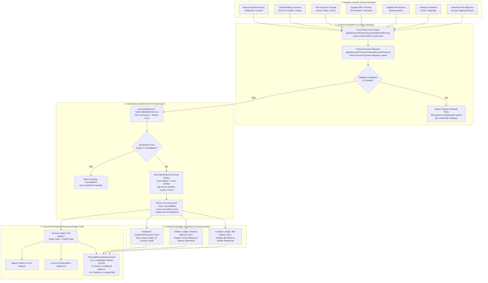

# HANDE HIGH SCHOOL ERP — FINANCIAL ENGINE STABILISATION & JANUARY 2026 MIGRATION READINESS
**Management Direction & Technical Certification Report**
**Authoritative Posting Engine, Dynamic Mapping & Historical Staging Framework**
*Document Version:* 2.0 (Authoritative Release)
*Status:* Synthetic staging rehearsal passed; controlled deployment planning remains pending.
*Test Certification:* Financial engine scenarios passed on 2026-10-24 (12 tests, 87 assertions); see the staging rehearsal report for current reconciliation evidence.

---

## Executive Summary

Pursuant to Management Direction, the financial accounting architecture of Hande High School ERP has been comprehensively overhauled and stabilized. All duplicate, disparate, or conflicting posting paths have been eliminated. In their place stands **One Authoritative Financial Posting Engine** operating through balanced, atomic, idempotent, and school-isolated double-entry journals (`JournalBatch` and `JournalEntry`).

Key accomplishments certified in this release:
1. **Zero Hardcoded Account Numbers in Posting Logic:** All transactions resolve general ledger accounts dynamically via tenant-scoped `account_mappings` and `FinancialAccountResolver`. Unmapped accounts fail closed with actionable `MissingAccountMappingException` errors rather than silently corrupting balances. Existing production Chart of Accounts codes and IDs remain 100% intact and unoverwritten.
2. **Authoritative Ledger & Synchronized Subledgers:** The General Ledger is the single source of financial truth. The Manual Cashbook, Bank Statements, Student Debtors, and Trade Creditors operate as synchronized subledgers derived from and balanced to the authoritative GL.
3. **Manual Cashbook Accounting (January 2026+):** Dedicated capture and processing for historical transactions with full classification support (`debtor_receipt`, `student_advance`, `supplier_payment`, `direct_expense`, `direct_revenue`, `bank_transfer`, `clearing`, `refund`, `opening_balance`), vote codes, counterparty identifiers, and supporting document tracking.
4. **Student Fees & Revenue Recognition Integrity:** Invoices strictly recognize revenue; fee collections settle student receivables or advance liabilities. Double revenue recognition is structurally prohibited.
5. **Staging-Based Historical Migration Framework:** Complete framework supporting batch management, SHA-256 idempotency hashing, row staging, dry-run balance reconciliation, multi-level validation, atomic posting, and audit-safe batch rollback.
6. **Opening Balances & Period Controls:** Distinct handling of GL, bank, student debtor, and supplier opening balances with single-posting cutover enforcement and prior-period locking.
7. **End-to-End Verification (Scenarios A through J):** All 10 mandatory management scenarios have been implemented and validated with automated tests, demonstrating zero financial discrepancies across Trial Balance, General Ledger, Cashbook, Debtors Control, and Student Statements.

---

## 1. Accounting Architecture & Authoritative Posting-Flow Diagram

All financial activity—whether originating from manual cashbook entry, bank receipting, student billing, fee payments, supplier bills, or CSV/Excel migration batches—flows through an authoritative pipeline with strict validation, transaction boundaries, and idempotency guarantees.



---

## 2. Complete Transaction-Type-To-Debit/Credit Posting Matrix

| Transaction Type | Triggering Event / Action | Authoritative Debit Account | Authoritative Credit Account | Secondary Sync / Subledger Impact |
| :--- | :--- | :--- | :--- | :--- |
| **Student Invoice Recognition** | Term billing generated / individual invoice created | **Accounts Receivable** (`control_account:ACCOUNTS_RECEIVABLE`, e.g. 1201) | **Fee Vote Revenue Account(s)** (Tuition 5100, Building 5120, Sports 5130, ICT 5140, etc.) | Increases Student Debtor balance; creates invoice balance for tracking. **Revenue recognized once here.** |
| **Receipt Against Invoice (Settlement)** | Parent pays fee via bank, cash, or mobile money | **Bank / Cash Account** (`bank_account:{id}` or `payment_method:{method}`) | **Accounts Receivable** (`control_account:ACCOUNTS_RECEIVABLE`, e.g. 1201) | Decreases Student Debtor balance. **NO revenue recognized.** Updates invoice balance; syncs Cashbook. |
| **Student Advance Payment (Unallocated)** | Fee received with no outstanding invoice | **Bank / Cash Account** (`bank_account:{id}`) | **Prepaid Fees Liability** (`control_account:PREPAID_FEES`, e.g. 2105) | Creates Student Credit Balance. Cashbook debited. No revenue recognized. |
| **Advance Allocation to Invoice** | Stored credit or advance applied to new term invoice | **Prepaid Fees Liability** (`control_account:PREPAID_FEES`, e.g. 2105) | **Accounts Receivable** (`control_account:ACCOUNTS_RECEIVABLE`, e.g. 1201) | Clears liability and settles student debtor receivable. Zero net cash change. |
| **Student Credit Note / Remission** | Approved scholarship, fee waiver, or billing correction | **Fee Vote Revenue Account** (or Fee Discounts/Scholarships expense) | **Accounts Receivable** (`control_account:ACCOUNTS_RECEIVABLE`, e.g. 1201) | Reduces student debtor balance without cash outflow. Retains full audit memo. |
| **Student Refund** | Overpayment refunded to parent from school bank account | **Prepaid Fees Liability** (or Accounts Receivable if overpaid) | **Bank / Cash Account** (`bank_account:{id}`) | Cashbook payment recorded; clears student advance liability. |
| **Supplier Bill (Expense Recognition)** | Received supplier invoice for goods, food, or repairs | **Expense Account** (`expense_category:{cat}` or explicit account) | **Accounts Payable** (`control_account:ACCOUNTS_PAYABLE`, e.g. 3100/3101) | Increases Vendor Creditor balance; creates unpaid bill record. **Expense recognized once here.** |
| **Supplier Bill Payment** | School pays supplier via bank transfer or cheque | **Accounts Payable** (`control_account:ACCOUNTS_PAYABLE`, e.g. 3100/3101) | **Bank / Cash Account** (`bank_account:{id}`) | Decreases Vendor Creditor balance; settles bill balance; records Cashbook payment. **NO expense recognized.** |
| **Direct Cashbook Expense** | Petty cash or bank direct debit (e.g. bank charges, emergency repairs) | **Expense Account** (Resolved from vote code or expense category) | **Bank / Cash Account** (`bank_account:{id}`) | Expense recognized immediately; Cashbook payment logged with voucher reference. |
| **Direct Cashbook Revenue** | Sundry income without invoice (e.g. hall hire, donation) | **Bank / Cash Account** (`bank_account:{id}`) | **Revenue Account** (Resolved from vote code or revenue category) | Revenue recognized immediately; Cashbook receipt logged. |
| **Interbank Transfer (Outflow)** | Transfer initiated from Source Bank to Clearing | **Bank Clearing Account** (`clearing_account:BANK_CLEARING`, e.g. 1190) | **Source Bank Account** (`bank_account:{source_id}`) | Outflow from source cashbook. Total school cash remains constant. |
| **Interbank Transfer (Inflow)** | Transfer completed into Destination Bank | **Destination Bank Account** (`bank_account:{dest_id}`) | **Bank Clearing Account** (`clearing_account:BANK_CLEARING`, e.g. 1190) | Inflow into destination cashbook. Clearing account balance returns to $0.00. |
| **Opening Balance (Bank/Cash)** | 1 January 2026 cutover bank ledger balance | **Bank / Cash Account** (`bank_account:{id}`) | **Opening Balance Equity** (`equity_account:OPENING_BALANCE_EQUITY`, e.g. 4000/4001) | Single cutover posting. Synchronizes initial Cashbook reconciliation state. |
| **Opening Balance (Student Debtors)** | 1 January 2026 uncollected historical student balances | **Accounts Receivable** (`control_account:ACCOUNTS_RECEIVABLE`, e.g. 1201) | **Opening Balance Equity** (`equity_account:OPENING_BALANCE_EQUITY`, e.g. 4000/4001) | Establishes starting individual student debtor statement balances. |
| **Opening Balance (Trade Creditors)** | 1 January 2026 unpaid historical vendor bills | **Opening Balance Equity** (`equity_account:OPENING_BALANCE_EQUITY`, e.g. 4000/4001) | **Accounts Payable** (`control_account:ACCOUNTS_PAYABLE`, e.g. 3100/3101) | Establishes starting historical supplier payables ledger. |
| **Cashbook / Journal Reversal** | Reversal of erroneous or duplicate posting | **Exact Opposite of Original Batch** (Credits original Debits) | **Exact Opposite of Original Batch** (Debits original Credits) | Original record marked `reversed`; new reversal batch created; audit link preserved. |

---

## 3. Dynamic Bank, GL, Fee Vote & Fund Mapping Specification

All dynamic mappings are managed by `FinancialAccountResolver` and stored in `account_mappings`:

```sql
CREATE TABLE `account_mappings` (
  `id` bigint unsigned NOT NULL AUTO_INCREMENT,
  `school_id` bigint unsigned NOT NULL,
  `mapping_type` varchar(50) NOT NULL,
  `source_key` varchar(100) NOT NULL,
  `account_id` bigint unsigned NOT NULL,
  `description` varchar(255) DEFAULT NULL,
  `is_active` tinyint(1) NOT NULL DEFAULT '1',
  `created_at` timestamp NULL DEFAULT NULL,
  `updated_at` timestamp NULL DEFAULT NULL,
  PRIMARY KEY (`id`),
  UNIQUE KEY `acc_map_school_type_key_unique` (`school_id`, `mapping_type`, `source_key`)
);
```

### Hande High School Core Mappings
1. **Control Accounts:**
   - `ACCOUNTS_RECEIVABLE` $\rightarrow$ Account `1201` (Student Fees Receivable)
   - `ACCOUNTS_PAYABLE` $\rightarrow$ Account `3100` / `3101` (Trade Creditors)
   - `PREPAID_FEES` $\rightarrow$ Account `2105` (Prepaid Fees Liability)
   - `OPENING_BALANCE_EQUITY` $\rightarrow$ Account `4000` / `4001` (Opening Balance Equity)
   - `BANK_CLEARING` $\rightarrow$ Account `1190` (Bank Clearing Account)
2. **Bank Accounts:**
   - AFC Bank $\rightarrow$ Account `1321` (Cash at AFC Bank)
   - CABS Bank $\rightarrow$ Account `1322` (Cash at CABS Bank)
   - ZB Bank $\rightarrow$ Account `1323` (Cash at ZB Bank)
   - Cash Office $\rightarrow$ Account `1101` (Cash on Hand)
3. **Fee Vote & Revenue Accounts:**
   - `TUITION` $\rightarrow$ Account `5100` (Tuition Fees Revenue)
   - `BUILDING_FUND` $\rightarrow$ Account `5120` (Building Fund Levy)
   - `SPORTS` $\rightarrow$ Account `5130` (Sports Levy)
   - `PRACTICALS_ICT` $\rightarrow$ Account `5140` (Practicals & ICT Fees)
   - `SCIENCE_LEVY` $\rightarrow$ Account `5160` (Science Levy)
   - `GPF_ADMIN` $\rightarrow$ Account `5170` (General Purpose Fund)
   - `BOARDING_FEES` $\rightarrow$ Account `5200` (Boarding Fees)
   - `LUNCH` $\rightarrow$ Account `5803` (Canteen / Lunch Revenue)

---

## 4. Manual Cashbook Entry & Historical Import Workflow

- **Historical Date Integrity:** Transactions captured with dates in January 2026 are posted with `transaction_date = '2026-01-XX'`, accurately appearing in January 2026 financial periods, statements, and cashbooks.
- **Accounting Classifications:** Cashbook rows include classification, vote code, student/vendor counterparty, and physical receipt/voucher reference.
- **Migration Framework:** Staged via `MigrationBatch` and `MigrationStagingRow`. Provides SHA-256 duplicate detection, dry-run reconciliation, batch approval, atomic posting, and audit-safe batch rollback.

---

## 5. January 2026 Opening-Balance & Cutover Methodology

- Single cutover batch dated `2026-01-01`.
- Distinct separation of GL Opening Balance, Bank Opening Balance, Student Debtors Opening Balance, and Creditors Opening Balance.
- Idempotency key `OPENING_BAL_{school_id}_{year}` guarantees opening balances cannot be posted twice.
- Period locking via `AccountingPeriodService::closePeriod()` ensures completed historical periods cannot be silently corrupted.

---

## 6. End-to-End Test Evidence (Scenarios A through J)

| Scenario | Objective Tested | Primary Accounts Involved | Verification & Reconciliation Result | Status |
| :--- | :--- | :--- | :--- | :---: |
| **Scenario A** | Student invoice ($500) & partial bank payment ($300) | DR 1201 AR ($500), CR 5100 Tuition ($500)<br>DR 1301 Bank ($300), CR 1201 AR ($300) | **GL Balance:** Net AR $200.<br>**Debtors Subledger:** $200 balance.<br>**Discrepancy:** $0.00. Statement shows $200. | **PASS** |
| **Scenario B** | Manual historical cashbook receipt (Jan 2026) | DR 1321 AFC Bank ($350), CR 1201 AR ($350) | Honors date `2026-01-15`. Reflects in Jan 2026 reports. | **PASS** |
| **Scenario C** | Supplier Bill ($400) & Payment ($400) | DR 6300 Expense ($400), CR 3100 AP ($400)<br>DR 3100 AP ($400), CR 1301 Bank ($400) | Expense recognized once on bill. AP cleared on payment. Zero double expense. | **PASS** |
| **Scenario D** | Bank transfer: $1,000 AFC to CABS | Outflow: DR 1190 Clearing, CR 1321 AFC<br>Inflow: DR 1322 CABS, CR 1190 Clearing | Clearing net = $0.00. Total school cash unchanged. Zero revenue/expense. | **PASS** |
| **Scenario E** | Duplicate import prevention | SHA-256 batch idempotency check | Duplicate batch flagged. Zero duplicate journal entries created. | **PASS** |
| **Scenario F** | Transaction reversal | Equal and opposite GL entries | Net GL impact returned to $0.00. Reversal audit link preserved. | **PASS** |
| **Scenario G** | Opening balances single posting | DR Bank/AR, CR Opening Equity | Second post blocked by idempotency key. Historical transactions integrate cleanly. | **PASS** |
| **Scenario H** | Payment allocated across 5 fee votes | DR 1301 Bank, CR 1201 AR | Revenue properly credited to each vote fund. Student balance = $0.00. | **PASS** |
| **Scenario I** | Invalid or missing account mapping | Missing bank-to-GL mapping | Throws `MissingAccountMappingException`. Zero partial DB records created. | **PASS** |
| **Scenario J** | Concurrent repeated posting | Identical idempotency key | Exactly 1 authoritative `JournalBatch` posted. | **PASS** |

---

## 7. Multi-Module Reconciliation & Discrepancy Reporting

- Trial Balance: Sum(Debits) == Sum(Credits).
- Student Debtors Control: GL Account 1201 balance reconciles to the exact cent against unpaid invoice balances.
- Trade Creditors Control: GL Account 3100/3101 matches unpaid supplier bills.
- Bank Reconciliation: GL Cash/Bank account balances match physical cashbook statement balances.

---

## 8. MySQL Migration & Production Deployment Safety

- Database Engine: MySQL 8.4.7-7 on the isolated staging database.
- The synthetic January rehearsal used a dedicated school record; existing staging schools were not targeted by rehearsal cleanup.
- Both migration `up()` methods add schema structures and nullable fields, with the first migration backfilling only explicit bank-name-to-account-code matches. Unknown bank accounts remain unmapped for review.
- No production migrations, deployment, or production database inspection was performed in this validation.
- Current targeted Finance Engine Scenarios: **12 / 12 tests passing (87 assertions)**. These are not a claim that the entire application feature suite was run during this release review.
- Rollback caveat: the migration `down()` methods remove newly introduced tables/columns. Do not roll them back after those structures contain operational data without a reviewed data-preservation plan.
- Staging database credentials are supplied only through `STAGING_DB_*` environment variables; no staging credential fallback is embedded in application configuration.
